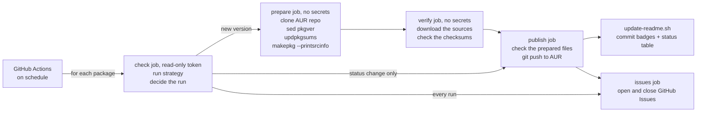

# sibyl

<!-- BADGES:START -->
    
<!-- BADGES:END -->

Automated AUR package updates from a single GitHub repo.  
[Fork it](https://github.com/staticwire/aurtomator/fork), drop in your packages, let CI handle the rest.

## Packages

<!-- PACKAGES:START -->
 

<table>
<tr><th>Package</th><th>Version</th><th>Strategy</th><th>Updated</th><th>Status</th></tr>
<tr><td><a href="https://aur.archlinux.org/pkgbase/dbhub-mcp-server">dbhub-mcp-server</a></td><td>1.5.0</td><td nowrap>npm</td><td nowrap>—</td><td nowrap>✅ up to date</td></tr>
<tr><td><a href="https://aur.archlinux.org/pkgbase/jdk-openjdk-ea">jdk-openjdk-ea</a></td><td>28+21</td><td nowrap>github-tag</td><td nowrap>—</td><td nowrap>✅ up to date</td></tr>
<tr><td><a href="https://aur.archlinux.org/pkgbase/jdk-temurin-ea-bin">jdk-temurin-ea-bin</a></td><td>28+21</td><td nowrap>webpage-scrape</td><td nowrap>—</td><td nowrap>✅ up to date</td></tr>
<tr><td><a href="https://aur.archlinux.org/pkgbase/kio-s3-git">kio-s3-git</a></td><td>r510.3cc7ccc</td><td nowrap>git-latest</td><td nowrap>2026-10-27</td><td nowrap>📦 updated to r510.3cc7ccc</td></tr>
<tr><td><a href="https://aur.archlinux.org/pkgbase/kio-s3">kio-s3</a></td><td>1.0.2</td><td nowrap>kde-tarball</td><td nowrap>2026-04-24</td><td nowrap>✅ up to date</td></tr>
<tr><td><a href="https://aur.archlinux.org/pkgbase/kqalc-bin">kqalc-bin</a></td><td>0.2.2</td><td nowrap>github-release</td><td nowrap>—</td><td nowrap>✅ up to date</td></tr>
<tr><td><a href="https://aur.archlinux.org/pkgbase/liblinear">liblinear</a></td><td>2.50</td><td nowrap>webpage-scrape</td><td nowrap>—</td><td nowrap>✅ up to date</td></tr>
<tr><td><a href="https://aur.archlinux.org/pkgbase/linux-exploit-suggester">linux-exploit-suggester</a></td><td>1.2</td><td nowrap>github-tag</td><td nowrap>—</td><td nowrap>✅ up to date</td></tr>
<tr><td><a href="https://aur.archlinux.org/pkgbase/marp-cli-bin">marp-cli-bin</a></td><td>4.5.1</td><td nowrap>github-release</td><td nowrap>2026-09-06</td><td nowrap>✅ up to date</td></tr>
<tr><td><a href="https://aur.archlinux.org/pkgbase/memos-bin">memos-bin</a></td><td>0.31.0</td><td nowrap>github-release</td><td nowrap>2026-09-19</td><td nowrap>✅ up to date</td></tr>
<tr><td><a href="https://aur.archlinux.org/pkgbase/miniflux-bin">miniflux-bin</a></td><td>2.3.4</td><td nowrap>github-release</td><td nowrap>2026-10-20</td><td nowrap>✅ up to date</td></tr>
<tr><td><a href="https://aur.archlinux.org/pkgbase/neovim-nightly-bin">neovim-nightly-bin</a></td><td>0.13.0+dev+1952+g187d13aa60</td><td nowrap>github-nightly</td><td nowrap>2026-10-26</td><td nowrap>✅ up to date</td></tr>
<tr><td><a href="https://aur.archlinux.org/pkgbase/pgconsole">pgconsole</a></td><td>1.3.0</td><td nowrap>npm</td><td nowrap>—</td><td nowrap>✅ up to date</td></tr>
<tr><td><a href="https://aur.archlinux.org/pkgbase/pgtui-bin">pgtui-bin</a></td><td>0.3.0</td><td nowrap>github-release</td><td nowrap>—</td><td nowrap>✅ up to date</td></tr>
<tr><td><a href="https://aur.archlinux.org/pkgbase/pgtui">pgtui</a></td><td>0.3.0</td><td nowrap>github-release</td><td nowrap>—</td><td nowrap>✅ up to date</td></tr>
<tr><td><a href="https://aur.archlinux.org/pkgbase/sherpa-onnx-bin">sherpa-onnx-bin</a></td><td>2.0.1</td><td nowrap>github-release</td><td nowrap>2026-10-26</td><td nowrap>✅ up to date</td></tr>
<tr><td><a href="https://aur.archlinux.org/pkgbase/sherpa-onnx-piper-voice-ru-denis">sherpa-onnx-piper-voice-ru-denis</a></td><td>20251202</td><td nowrap>github-asset</td><td nowrap>—</td><td nowrap>✅ up to date</td></tr>
<tr><td><a href="https://aur.archlinux.org/pkgbase/sherpa-onnx-piper-voice-ru-dmitri">sherpa-onnx-piper-voice-ru-dmitri</a></td><td>20251202</td><td nowrap>github-asset</td><td nowrap>—</td><td nowrap>✅ up to date</td></tr>
<tr><td><a href="https://aur.archlinux.org/pkgbase/sherpa-onnx-piper-voice-ru-ruslan">sherpa-onnx-piper-voice-ru-ruslan</a></td><td>20251202</td><td nowrap>github-asset</td><td nowrap>—</td><td nowrap>✅ up to date</td></tr>
<tr><td><a href="https://aur.archlinux.org/pkgbase/transfuse">transfuse</a></td><td>0.6.0</td><td nowrap>gitlab-tag</td><td nowrap>—</td><td nowrap>✅ up to date</td></tr>
<tr><td><a href="https://aur.archlinux.org/pkgbase/wireguard-gui-bin">wireguard-gui-bin</a></td><td>0.1.13</td><td nowrap>github-release</td><td nowrap>2026-10-26</td><td nowrap>✅ up to date</td></tr>
<tr><td><a href="https://aur.archlinux.org/pkgbase/ydiskarc">ydiskarc</a></td><td>1.1.0</td><td nowrap>pypi</td><td nowrap>—</td><td nowrap>✅ up to date</td></tr>
</table>

aurtomator 0.6.1 <!-- x-release-please-version -->
<!-- PACKAGES:END -->

*Auto-generated by CI after each run.*

## How it works

Each package has a YAML config pointing to an upstream source. A first job runs the strategies and decides what the run does. When a new version is detected, aurtomator clones the existing AUR repo, bumps `pkgver`, regenerates checksums and `.SRCINFO`, and pushes. A PKGBUILD is code, so these steps run in a job without secrets, and the jobs after it take the statuses from the first job. A second job without secrets downloads the sources and checks the checksums, and the job that pushes checks the result once more. It does not generate PKGBUILDs or modify anything else. A package that starts failing gets a GitHub Issue, and so does a failed run of the workflow.

## Quick start

1. Fork this repo (or use as template)
2. Enable Actions and Issues in your fork's Settings ([why?](docs/SETUP.md#after-forking))
3. Run `./scripts/setup.sh` ([detailed guide](docs/SETUP.md))
4. Add a package: `cp packages/example.yml.sample packages/<name>.yml`
5. Validate: `./scripts/validate-pkg.sh <name>`
6. Push and let CI handle the rest

The setup script configures your identity (git author for AUR commits), SSH access, and GitHub Secrets. With [gh CLI](https://cli.github.com/) it sets the secrets itself. Without it, the script prints manual instructions. GPG commit signing is optional.

## Strategies

15 built-in version detection strategies:

| Strategy           | Source              | Use for                              |
|--------------------|---------------------|--------------------------------------|
| `github-release`   | GitHub Releases API | GitHub-hosted projects with releases |
| `github-tag`       | `git ls-remote`     | GitHub projects without releases     |
| `github-nightly`   | GitHub Releases API | Nightly/prerelease builds (4 patterns) |
| `github-asset`     | GitHub Releases API | Assets re-uploaded on a fixed tag    |
| `gitlab-tag`       | GitLab Tags API     | Any GitLab instance                  |
| `gitea-tag`        | Gitea/Forgejo API   | Codeberg, self-hosted Gitea          |
| `git-tag`          | `git ls-remote`     | Any HTTPS git host, such as sourcehut |
| `git-latest`       | `git clone --bare`  | `-git` packages, any HTTPS git repo  |
| `pypi`             | PyPI JSON API       | Python packages                      |
| `npm`              | npm registry        | Node.js packages                     |
| `crates`           | crates.io API       | Rust crates                          |
| `repology`         | Repology API        | Universal fallback (120+ repos)      |
| `archpkg`          | Arch repos API      | The pkgver of an official package    |
| `webpage-scrape`   | URL + regex         | Anything not covered above           |
| `kde-tarball`      | download.kde.org    | KDE projects, Plasma and Gear too    |

See [docs/WORKFLOW.md](docs/WORKFLOW.md) for strategy details, YAML examples, and how to write custom strategies.

## Limitations

aurtomator only sets `pkgver`, resets `pkgrel` to 1, updates checksums and `.SRCINFO`, and sets a value from a release asset name where the package YAML asks for one. It does not build packages or check dependencies. These cases are detected and blocked:

- **`pkgver()` with the wrong strategy**: use `git-latest` for VCS packages
- **A `SKIP` next to a real checksum of a remote source**: such a `SKIP` turns off `updpkgsums`, and the real checksum would go stale. The `SKIP` of a signature (`.sig`, `.sign`, `.asc`) and that of a VCS source without a `#commit=`, `#tag=` or `#revision=` pin do not count, because makepkg gives them `SKIP` itself
- **Sources that do not follow `pkgver`**: when a download has a real checksum or a VCS source is pinned, a bump has to change a source URL or a checksum, or the new version would hold the old files. Make `pkgver` the literal and derive the other variable from it
- **Source URLs returning HTML** or an error status: a HEAD request checks every `http` and `https` source, also one with a `SKIP` checksum

Patches in `source=()` trigger a warning and are not blocked.

[docs/SUPPORTED-PACKAGES.md](docs/SUPPORTED-PACKAGES.md) has the full breakdown, including safe and unsafe failure modes and a comparison with other tools.

## Downgrades

aurtomator publishes a version older than the tracked one only when the package YAML sets `allow_downgrade: true`. Without it, the downgrade is skipped: the latest release of a GitHub project can be a maintenance release of an older line. A downgrade is logged with the literal keyword `DOWNGRADE` and shown in the package table with a `🔻` icon. It counts as a successful run, so the badge stays green. Details are in [docs/WORKFLOW.md section 4.3](docs/WORKFLOW.md#43-downgrade-behavior).

An update whose first number has at least two digits more than that of the tracked version, such as `13 → 2026102100`, is skipped the same way unless the package YAML sets `allow_version_jump: true`. Such a step is more often another version scheme of the upstream, as build tags next to release tags, than a release. It is shown with a `🔺` icon.

## Update alerts

A package YAML can name the versions that need a hand edit of the PKGBUILD, such as a new major that needs a newer build dependency. An alert with `hold: true` pauses the update at such a version, shown with a `✋` icon, and opens an issue with the note until the maintainer publishes the version by hand. Without `hold`, the update goes on, and an issue with the note opens after the push. Details are in [docs/WORKFLOW.md section 4.5](docs/WORKFLOW.md#45-update-alerts).

## Values from release asset names

Some upstreams name a release asset with more than the version and rebuild a release under a new name, as liquidsoap does with `liquidsoap_2.4.6-debian-forky-ocaml5.4.0-3_amd64.deb`. With `upstream.asset_regex` and `upstream.asset_var`, a run takes that value from the release of the new version and writes it to its line in the PKGBUILD. A new value of the current version is pushed as a rebuild with the next `pkgrel`, shown with a `🔨` icon. While the release or its asset is not out yet, the package shows `⏳` for up to a day. Details are in [docs/WORKFLOW.md section 4.6](docs/WORKFLOW.md#46-values-from-release-asset-names).

## Updates of aurtomator

`VERSION` holds the version of aurtomator a repository runs, and the package table shows it. When a newer aurtomator release is out, a run links it under the table and opens an issue, which closes once the fork has merged the release. Details are in [docs/WORKFLOW.md section 5.8](docs/WORKFLOW.md#58-version-of-aurtomator).

## Resource usage

All packages run in one workflow run. `check` and `issues` run every time, `prepare` and `verify` only for a new version, and `publish` for a new version or a change in the status table. Each of these jobs starts its own Arch container and installs its packages. SSH and GPG are set up once per run, in `publish`. A version check is a few API requests per package, or a bare clone for `git-latest`.

## Documentation

- [Setup guide](docs/SETUP.md): first-time configuration, prerequisites, troubleshooting
- [Supported packages](docs/SUPPORTED-PACKAGES.md): what works, what does not, safety rules
- [Workflow reference](docs/WORKFLOW.md): strategies, update process, CI pipeline, local testing, custom strategies

## Alternatives

| Tool              | Best for                  | Approach                          |
|-------------------|---------------------------|-----------------------------------|
| [nvchecker]       | Version detection only    | Python, 40+ sources, no AUR push  |
| [lilac]           | Large repos (archlinuxcn) | Full build bot, needs own infra   |
| [aur-auto-update] | Centralized service       | Requires bot co-maintainer on AUR |
| [Renovate]        | Multi-ecosystem           | Enterprise-grade, heavy config    |
| **aurtomator**    | Individual maintainers    | Fork and go                       |

[nvchecker]: https://github.com/lilydjwg/nvchecker
[lilac]: https://github.com/archlinuxcn/lilac
[aur-auto-update]: https://github.com/arch4edu/aur-auto-update
[Renovate]: https://docs.renovatebot.com/user-stories/maintaining-aur-packages-with-renovate/

## License

BSD-3-Clause
