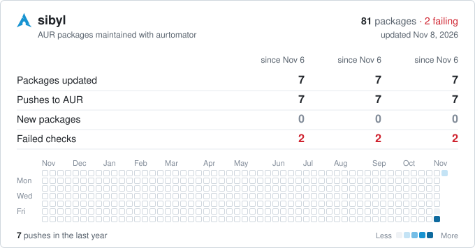

# sibyl

<!-- BADGES:START -->
  
<!-- BADGES:END -->

This is a repository for AUR packages. Each package has a config in `packages/`, and [aurtomator](https://github.com/staticwire/aurtomator) checks it for new upstream versions on a schedule and pushes the updates to the AUR.

## Packages

<!-- PACKAGES:START -->
<a href="stats/events.csv">
<picture>
  <source media="(prefers-color-scheme: dark)" srcset="stats/card-dark.svg">
  
</picture>
</a>

<table>
<tr><th>Package</th><th>Version</th><th>Strategy</th><th>Updated</th><th>Status</th></tr>
<tr><td><a href="https://aur.archlinux.org/pkgbase/all-smi-bin">all-smi-bin</a></td><td>0.28.1</td><td nowrap>github-release</td><td nowrap>-</td><td nowrap>✅ up to date</td></tr>
<tr><td><a href="https://aur.archlinux.org/pkgbase/all-smi">all-smi</a></td><td>0.28.1</td><td nowrap>github-release</td><td nowrap>-</td><td nowrap>✅ up to date</td></tr>
<tr><td><a href="https://aur.archlinux.org/pkgbase/centrifugo-bin">centrifugo-bin</a></td><td>6.10.3</td><td nowrap>github-release</td><td nowrap>2026-11-08</td><td nowrap>✅ up to date</td></tr>
<tr><td><a href="https://aur.archlinux.org/pkgbase/centrifugo-git">centrifugo-git</a></td><td>r2017.4b6d86e</td><td nowrap>git-latest</td><td nowrap>2026-11-10</td><td nowrap>✅ up to date</td></tr>
<tr><td><a href="https://aur.archlinux.org/pkgbase/centrifugo">centrifugo</a></td><td>6.10.3</td><td nowrap>github-release</td><td nowrap>2026-11-08</td><td nowrap>✅ up to date</td></tr>
<tr><td><a href="https://aur.archlinux.org/pkgbase/dbhub-mcp-server">dbhub-mcp-server</a></td><td>1.6.1</td><td nowrap>npm</td><td nowrap>2026-11-11</td><td nowrap>✅ up to date</td></tr>
<tr><td><a href="https://aur.archlinux.org/pkgbase/deja-vu-bin">deja-vu-bin</a></td><td>0.24.1</td><td nowrap>github-release</td><td nowrap>-</td><td nowrap>✅ up to date</td></tr>
<tr><td><a href="https://aur.archlinux.org/pkgbase/deja-vu">deja-vu</a></td><td>0.24.1</td><td nowrap>github-release</td><td nowrap>-</td><td nowrap>✅ up to date</td></tr>
<tr><td><a href="https://aur.archlinux.org/pkgbase/disc-image-studio-bin">disc-image-studio-bin</a></td><td>1.5.0</td><td nowrap>github-release</td><td nowrap>2026-11-07</td><td nowrap>✅ up to date</td></tr>
<tr><td><a href="https://aur.archlinux.org/pkgbase/disc-image-studio-git">disc-image-studio-git</a></td><td>r91.c720fd4</td><td nowrap>git-latest</td><td nowrap>2026-11-06</td><td nowrap>💤 next update 2026-11-13</td></tr>
<tr><td><a href="https://aur.archlinux.org/pkgbase/disc-image-studio">disc-image-studio</a></td><td>1.5.0</td><td nowrap>github-release</td><td nowrap>2026-11-07</td><td nowrap>✅ up to date</td></tr>
<tr><td><a href="https://aur.archlinux.org/pkgbase/doltlite-bin">doltlite-bin</a></td><td>0.51.10</td><td nowrap>github-release</td><td nowrap>2026-11-08</td><td nowrap>✅ up to date</td></tr>
<tr><td><a href="https://aur.archlinux.org/pkgbase/doltlite">doltlite</a></td><td>0.51.10</td><td nowrap>github-release</td><td nowrap>2026-11-08</td><td nowrap>✅ up to date</td></tr>
<tr><td><a href="https://aur.archlinux.org/pkgbase/evernote2md-bin">evernote2md-bin</a></td><td>0.23.0</td><td nowrap>github-release</td><td nowrap>-</td><td nowrap>✅ up to date</td></tr>
<tr><td><a href="https://aur.archlinux.org/pkgbase/evernote2md">evernote2md</a></td><td>0.23.0</td><td nowrap>github-release</td><td nowrap>-</td><td nowrap>✅ up to date</td></tr>
<tr><td><a href="https://aur.archlinux.org/pkgbase/gator-bin">gator-bin</a></td><td>3.23.1</td><td nowrap>github-release</td><td nowrap>-</td><td nowrap>✅ up to date</td></tr>
<tr><td><a href="https://aur.archlinux.org/pkgbase/gator">gator</a></td><td>3.23.1</td><td nowrap>github-release</td><td nowrap>-</td><td nowrap>✅ up to date</td></tr>
<tr><td><a href="https://aur.archlinux.org/pkgbase/ghostunnel-bin">ghostunnel-bin</a></td><td>1.11.5</td><td nowrap>github-release</td><td nowrap>-</td><td nowrap>✅ up to date</td></tr>
<tr><td><a href="https://aur.archlinux.org/pkgbase/ghostunnel">ghostunnel</a></td><td>1.11.5</td><td nowrap>github-release</td><td nowrap>-</td><td nowrap>✅ up to date</td></tr>
<tr><td><a href="https://aur.archlinux.org/pkgbase/greenmask-bin">greenmask-bin</a></td><td>0.2.26</td><td nowrap>github-release</td><td nowrap>-</td><td nowrap>✅ up to date</td></tr>
<tr><td><a href="https://aur.archlinux.org/pkgbase/greenmask-git">greenmask-git</a></td><td>r614.eec5bd5</td><td nowrap>git-latest</td><td nowrap>2026-11-06</td><td nowrap>✅ up to date</td></tr>
<tr><td><a href="https://aur.archlinux.org/pkgbase/greenmask">greenmask</a></td><td>0.2.26</td><td nowrap>github-release</td><td nowrap>-</td><td nowrap>✅ up to date</td></tr>
<tr><td><a href="https://aur.archlinux.org/pkgbase/jdk-openjdk-ea">jdk-openjdk-ea</a></td><td>28+23</td><td nowrap>github-tag</td><td nowrap>2026-11-05</td><td nowrap>✅ up to date</td></tr>
<tr><td><a href="https://aur.archlinux.org/pkgbase/jdk-temurin-ea-bin">jdk-temurin-ea-bin</a></td><td>28+22</td><td nowrap>webpage-scrape</td><td nowrap>2026-11-01</td><td nowrap>❌ failed</td></tr>
<tr><td><a href="https://aur.archlinux.org/pkgbase/keep-sorted-bin">keep-sorted-bin</a></td><td>0.10.0</td><td nowrap>github-release</td><td nowrap>-</td><td nowrap>✅ up to date</td></tr>
<tr><td><a href="https://aur.archlinux.org/pkgbase/keep-sorted">keep-sorted</a></td><td>0.10.0</td><td nowrap>github-release</td><td nowrap>-</td><td nowrap>✅ up to date</td></tr>
<tr><td><a href="https://aur.archlinux.org/pkgbase/kio-s3-git">kio-s3-git</a></td><td>r523.98a09b5</td><td nowrap>git-latest</td><td nowrap>2026-11-06</td><td nowrap>💤 next update 2026-11-13</td></tr>
<tr><td><a href="https://aur.archlinux.org/pkgbase/kio-s3">kio-s3</a></td><td>1.0.2</td><td nowrap>kde-tarball</td><td nowrap>2026-04-24</td><td nowrap>✅ up to date</td></tr>
<tr><td><a href="https://aur.archlinux.org/pkgbase/kiota-bin">kiota-bin</a></td><td>1.38.0</td><td nowrap>github-release</td><td nowrap>-</td><td nowrap>✅ up to date</td></tr>
<tr><td><a href="https://aur.archlinux.org/pkgbase/kiota">kiota</a></td><td>1.38.0</td><td nowrap>github-release</td><td nowrap>-</td><td nowrap>✅ up to date</td></tr>
<tr><td><a href="https://aur.archlinux.org/pkgbase/kqalc-bin">kqalc-bin</a></td><td>0.2.3</td><td nowrap>github-release</td><td nowrap>-</td><td nowrap>✅ up to date</td></tr>
<tr><td><a href="https://aur.archlinux.org/pkgbase/krakend-bin">krakend-bin</a></td><td>3.0.3</td><td nowrap>github-release</td><td nowrap>-</td><td nowrap>✅ up to date</td></tr>
<tr><td><a href="https://aur.archlinux.org/pkgbase/krakend">krakend</a></td><td>3.0.3</td><td nowrap>github-release</td><td nowrap>-</td><td nowrap>✅ up to date</td></tr>
<tr><td><a href="https://aur.archlinux.org/pkgbase/kubecm-bin">kubecm-bin</a></td><td>0.36.0</td><td nowrap>github-release</td><td nowrap>-</td><td nowrap>✅ up to date</td></tr>
<tr><td><a href="https://aur.archlinux.org/pkgbase/kubecm">kubecm</a></td><td>0.36.0</td><td nowrap>github-release</td><td nowrap>-</td><td nowrap>✅ up to date</td></tr>
<tr><td><a href="https://aur.archlinux.org/pkgbase/lakekeeper-bin">lakekeeper-bin</a></td><td>0.15.0</td><td nowrap>github-release</td><td nowrap>2026-11-06</td><td nowrap>✅ up to date</td></tr>
<tr><td><a href="https://aur.archlinux.org/pkgbase/lakekeeper">lakekeeper</a></td><td>0.15.0</td><td nowrap>github-release</td><td nowrap>2026-11-06</td><td nowrap>✅ up to date</td></tr>
<tr><td><a href="https://aur.archlinux.org/pkgbase/liblinear">liblinear</a></td><td>2.50</td><td nowrap>webpage-scrape</td><td nowrap>-</td><td nowrap>✅ up to date</td></tr>
<tr><td><a href="https://aur.archlinux.org/pkgbase/linux-exploit-suggester">linux-exploit-suggester</a></td><td>1.2</td><td nowrap>github-tag</td><td nowrap>-</td><td nowrap>✅ up to date</td></tr>
<tr><td><a href="https://aur.archlinux.org/pkgbase/liquidsoap-bin">liquidsoap-bin</a></td><td>2.5.0rc1</td><td nowrap>github-tag</td><td nowrap>-</td><td nowrap>✅ up to date</td></tr>
<tr><td><a href="https://aur.archlinux.org/pkgbase/marp-cli-bin">marp-cli-bin</a></td><td>4.5.1</td><td nowrap>github-release</td><td nowrap>2026-09-06</td><td nowrap>✅ up to date</td></tr>
<tr><td><a href="https://aur.archlinux.org/pkgbase/mcp-grafana-bin">mcp-grafana-bin</a></td><td>2.3.0</td><td nowrap>github-release</td><td nowrap>2026-11-10</td><td nowrap>✅ up to date</td></tr>
<tr><td><a href="https://aur.archlinux.org/pkgbase/mcp-grafana">mcp-grafana</a></td><td>2.3.0</td><td nowrap>github-release</td><td nowrap>2026-11-10</td><td nowrap>✅ up to date</td></tr>
<tr><td><a href="https://aur.archlinux.org/pkgbase/mcp-toolbox-bin">mcp-toolbox-bin</a></td><td>1.16.0</td><td nowrap>github-release</td><td nowrap>2026-11-06</td><td nowrap>✅ up to date</td></tr>
<tr><td><a href="https://aur.archlinux.org/pkgbase/mcp-toolbox-git">mcp-toolbox-git</a></td><td>r2380.d373dc1</td><td nowrap>git-latest</td><td nowrap>2026-11-06</td><td nowrap>💤 next update 2026-11-13</td></tr>
<tr><td><a href="https://aur.archlinux.org/pkgbase/mcp-toolbox">mcp-toolbox</a></td><td>1.16.0</td><td nowrap>github-release</td><td nowrap>2026-11-05</td><td nowrap>✅ up to date</td></tr>
<tr><td><a href="https://aur.archlinux.org/pkgbase/mdbook-git">mdbook-git</a></td><td>0.5.4.r138.g0accb8a</td><td nowrap>git-latest</td><td nowrap>2026-11-06</td><td nowrap>💤 next update 2026-11-13</td></tr>
<tr><td><a href="https://aur.archlinux.org/pkgbase/mdbook-toc">mdbook-toc</a></td><td>0.15.4</td><td nowrap>crates</td><td nowrap>-</td><td nowrap>✅ up to date</td></tr>
<tr><td><a href="https://aur.archlinux.org/pkgbase/memos-bin">memos-bin</a></td><td>26.11.0</td><td nowrap>github-release</td><td nowrap>2026-09-19</td><td nowrap>✅ up to date</td></tr>
<tr><td><a href="https://aur.archlinux.org/pkgbase/merman-bin">merman-bin</a></td><td>0.9.3</td><td nowrap>github-release</td><td nowrap>2026-10-30</td><td nowrap>✅ up to date</td></tr>
<tr><td><a href="https://aur.archlinux.org/pkgbase/merman">merman</a></td><td>0.9.3</td><td nowrap>github-release</td><td nowrap>2026-10-30</td><td nowrap>✅ up to date</td></tr>
<tr><td><a href="https://aur.archlinux.org/pkgbase/miniflux-bin">miniflux-bin</a></td><td>2.3.5</td><td nowrap>github-release</td><td nowrap>2026-11-02</td><td nowrap>✅ up to date</td></tr>
<tr><td><a href="https://aur.archlinux.org/pkgbase/mp4ff-bin">mp4ff-bin</a></td><td>0.62.1</td><td nowrap>github-release</td><td nowrap>2026-11-10</td><td nowrap>✅ up to date</td></tr>
<tr><td><a href="https://aur.archlinux.org/pkgbase/mp4ff-git">mp4ff-git</a></td><td>r1328.8a0670f</td><td nowrap>git-latest</td><td nowrap>2026-11-11</td><td nowrap>✅ up to date</td></tr>
<tr><td><a href="https://aur.archlinux.org/pkgbase/mp4ff">mp4ff</a></td><td>0.62.1</td><td nowrap>github-release</td><td nowrap>2026-11-10</td><td nowrap>✅ up to date</td></tr>
<tr><td><a href="https://aur.archlinux.org/pkgbase/neo4j-mcp-bin">neo4j-mcp-bin</a></td><td>2.1.1</td><td nowrap>github-release</td><td nowrap>2026-11-11</td><td nowrap>✅ up to date</td></tr>
<tr><td><a href="https://aur.archlinux.org/pkgbase/neo4j-mcp">neo4j-mcp</a></td><td>2.1.1</td><td nowrap>github-release</td><td nowrap>2026-11-11</td><td nowrap>✅ up to date</td></tr>
<tr><td><a href="https://aur.archlinux.org/pkgbase/neovim-nightly-bin">neovim-nightly-bin</a></td><td>0.13.0+dev+2081+g5a53f3bb9e</td><td nowrap>github-nightly</td><td nowrap>2026-11-11</td><td nowrap>✅ up to date</td></tr>
<tr><td><a href="https://aur.archlinux.org/pkgbase/oasdiff-bin">oasdiff-bin</a></td><td>1.37.0</td><td nowrap>github-release</td><td nowrap>2026-11-08</td><td nowrap>✅ up to date</td></tr>
<tr><td><a href="https://aur.archlinux.org/pkgbase/oasdiff">oasdiff</a></td><td>1.37.0</td><td nowrap>github-release</td><td nowrap>2026-11-08</td><td nowrap>✅ up to date</td></tr>
<tr><td><a href="https://aur.archlinux.org/pkgbase/pg-schema-diff">pg-schema-diff</a></td><td>1.0.9</td><td nowrap>github-release</td><td nowrap>-</td><td nowrap>✅ up to date</td></tr>
<tr><td><a href="https://aur.archlinux.org/pkgbase/pgconsole">pgconsole</a></td><td>1.3.0</td><td nowrap>npm</td><td nowrap>-</td><td nowrap>✅ up to date</td></tr>
<tr><td><a href="https://aur.archlinux.org/pkgbase/pgstream-bin">pgstream-bin</a></td><td>1.6.0</td><td nowrap>github-release</td><td nowrap>2026-11-09</td><td nowrap>✅ up to date</td></tr>
<tr><td><a href="https://aur.archlinux.org/pkgbase/pgstream">pgstream</a></td><td>1.6.0</td><td nowrap>github-release</td><td nowrap>2026-11-08</td><td nowrap>✅ up to date</td></tr>
<tr><td><a href="https://aur.archlinux.org/pkgbase/pgtui-bin">pgtui-bin</a></td><td>0.3.0</td><td nowrap>github-release</td><td nowrap>-</td><td nowrap>✅ up to date</td></tr>
<tr><td><a href="https://aur.archlinux.org/pkgbase/pgtui">pgtui</a></td><td>0.3.0</td><td nowrap>github-release</td><td nowrap>-</td><td nowrap>✅ up to date</td></tr>
<tr><td><a href="https://aur.archlinux.org/pkgbase/plasma-drop">plasma-drop</a></td><td>1.17.8</td><td nowrap>github-release</td><td nowrap>2026-11-06</td><td nowrap>✅ up to date</td></tr>
<tr><td><a href="https://aur.archlinux.org/pkgbase/pocket-tts-bin">pocket-tts-bin</a></td><td>4.0.1</td><td nowrap>github-release</td><td nowrap>-</td><td nowrap>✅ up to date</td></tr>
<tr><td><a href="https://aur.archlinux.org/pkgbase/pocket-tts-git">pocket-tts-git</a></td><td>r214.0d20106</td><td nowrap>git-latest</td><td nowrap>2026-11-05</td><td nowrap>💤 next update 2026-11-12</td></tr>
<tr><td><a href="https://aur.archlinux.org/pkgbase/pocket-tts">pocket-tts</a></td><td>4.0.1</td><td nowrap>github-release</td><td nowrap>-</td><td nowrap>✅ up to date</td></tr>
<tr><td><a href="https://aur.archlinux.org/pkgbase/rsql-bin">rsql-bin</a></td><td>0.21.0</td><td nowrap>github-release</td><td nowrap>-</td><td nowrap>✅ up to date</td></tr>
<tr><td><a href="https://aur.archlinux.org/pkgbase/rsql">rsql</a></td><td>0.21.0</td><td nowrap>github-release</td><td nowrap>-</td><td nowrap>✅ up to date</td></tr>
<tr><td><a href="https://aur.archlinux.org/pkgbase/ryl-bin">ryl-bin</a></td><td>0.29.0</td><td nowrap>github-release</td><td nowrap>2026-11-06</td><td nowrap>✅ up to date</td></tr>
<tr><td><a href="https://aur.archlinux.org/pkgbase/ryl">ryl</a></td><td>0.29.0</td><td nowrap>github-release</td><td nowrap>2026-11-06</td><td nowrap>✅ up to date</td></tr>
<tr><td><a href="https://aur.archlinux.org/pkgbase/sherpa-onnx-bin">sherpa-onnx-bin</a></td><td>2.0.1</td><td nowrap>github-release</td><td nowrap>2026-10-26</td><td nowrap>✅ up to date</td></tr>
<tr><td><a href="https://aur.archlinux.org/pkgbase/sherpa-onnx-piper-voice-ru-denis">sherpa-onnx-piper-voice-ru-denis</a></td><td>20251202</td><td nowrap>github-asset</td><td nowrap>-</td><td nowrap>✅ up to date</td></tr>
<tr><td><a href="https://aur.archlinux.org/pkgbase/sherpa-onnx-piper-voice-ru-dmitri">sherpa-onnx-piper-voice-ru-dmitri</a></td><td>20251202</td><td nowrap>github-asset</td><td nowrap>-</td><td nowrap>✅ up to date</td></tr>
<tr><td><a href="https://aur.archlinux.org/pkgbase/sherpa-onnx-piper-voice-ru-ruslan">sherpa-onnx-piper-voice-ru-ruslan</a></td><td>20251202</td><td nowrap>github-asset</td><td nowrap>-</td><td nowrap>✅ up to date</td></tr>
<tr><td><a href="https://aur.archlinux.org/pkgbase/sngrep-bin">sngrep-bin</a></td><td>1.9.0</td><td nowrap>webpage-scrape</td><td nowrap>-</td><td nowrap>✅ up to date</td></tr>
<tr><td><a href="https://aur.archlinux.org/pkgbase/terratag-bin">terratag-bin</a></td><td>0.8.3</td><td nowrap>github-release</td><td nowrap>-</td><td nowrap>✅ up to date</td></tr>
<tr><td><a href="https://aur.archlinux.org/pkgbase/terratag">terratag</a></td><td>0.8.3</td><td nowrap>github-release</td><td nowrap>-</td><td nowrap>✅ up to date</td></tr>
<tr><td><a href="https://aur.archlinux.org/pkgbase/tinyice-bin">tinyice-bin</a></td><td>2.12.3</td><td nowrap>github-release</td><td nowrap>-</td><td nowrap>✅ up to date</td></tr>
<tr><td><a href="https://aur.archlinux.org/pkgbase/tinyice">tinyice</a></td><td>2.12.3</td><td nowrap>github-release</td><td nowrap>-</td><td nowrap>✅ up to date</td></tr>
<tr><td><a href="https://aur.archlinux.org/pkgbase/transfuse">transfuse</a></td><td>0.6.0</td><td nowrap>gitlab-tag</td><td nowrap>-</td><td nowrap>✅ up to date</td></tr>
<tr><td><a href="https://aur.archlinux.org/pkgbase/versitygw-bin">versitygw-bin</a></td><td>1.11.0</td><td nowrap>github-release</td><td nowrap>2026-11-06</td><td nowrap>✅ up to date</td></tr>
<tr><td><a href="https://aur.archlinux.org/pkgbase/versitygw">versitygw</a></td><td>1.11.0</td><td nowrap>github-release</td><td nowrap>2026-11-06</td><td nowrap>✅ up to date</td></tr>
<tr><td><a href="https://aur.archlinux.org/pkgbase/wal2json">wal2json</a></td><td>2.7</td><td nowrap>github-release</td><td nowrap>-</td><td nowrap>✅ up to date</td></tr>
<tr><td><a href="https://aur.archlinux.org/pkgbase/webdav-bin">webdav-bin</a></td><td>5.17.3</td><td nowrap>github-release</td><td nowrap>2026-10-30</td><td nowrap>✅ up to date</td></tr>
<tr><td><a href="https://aur.archlinux.org/pkgbase/webdav-git">webdav-git</a></td><td>r317.b6c41e4</td><td nowrap>git-latest</td><td nowrap>2026-11-11</td><td nowrap>✅ up to date</td></tr>
<tr><td><a href="https://aur.archlinux.org/pkgbase/webdav">webdav</a></td><td>5.17.3</td><td nowrap>github-release</td><td nowrap>2026-10-30</td><td nowrap>✅ up to date</td></tr>
<tr><td><a href="https://aur.archlinux.org/pkgbase/webtorrent-mpv-hook">webtorrent-mpv-hook</a></td><td>1.4.7</td><td nowrap>npm</td><td nowrap>-</td><td nowrap>✅ up to date</td></tr>
<tr><td><a href="https://aur.archlinux.org/pkgbase/whodb-bin">whodb-bin</a></td><td>0.138.0</td><td nowrap>github-release</td><td nowrap>2026-10-28</td><td nowrap>✅ up to date</td></tr>
<tr><td><a href="https://aur.archlinux.org/pkgbase/whodb-cli-bin">whodb-cli-bin</a></td><td>0.138.0</td><td nowrap>github-release</td><td nowrap>2026-10-28</td><td nowrap>✅ up to date</td></tr>
<tr><td><a href="https://aur.archlinux.org/pkgbase/wireguard-gui-bin">wireguard-gui-bin</a></td><td>0.1.13</td><td nowrap>github-release</td><td nowrap>2026-10-26</td><td nowrap>✅ up to date</td></tr>
<tr><td><a href="https://aur.archlinux.org/pkgbase/ydiskarc">ydiskarc</a></td><td>1.1.0</td><td nowrap>pypi</td><td nowrap>-</td><td nowrap>✅ up to date</td></tr>
</table>

aurtomator 0.11.0 ([0.12.0 available](https://github.com/staticwire/aurtomator/releases/tag/v0.12.0))
<!-- PACKAGES:END -->
